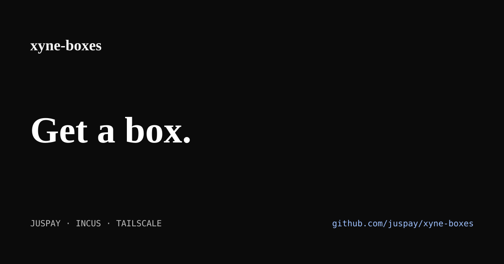

<div align="center">



# xyne-boxes

**Remote Linux dev boxes, one SSH away.**

### → [Setup &amp; usage](https://juspay.github.io/xyne-boxes/)

</div>

Library: [`packages/client`](packages/client/).

## Use as an Agent Plugin

The repository root is an [Agent Plugin](https://agent-plugins.org/specification) (v1.0.0), so any Agent Plugins client can reference it directly:

```sh
AI_PROFILE=github:juspay/xyne-boxes agent-distro omp
```

Clients that read the plugin get the `pu` skill (`skills/pu/`) — provisioning and driving Incus boxes with `pu create/connect/destroy`.

## Migrating from APM

APM support is removed. Move the dependency into your profile's `plugin.json`:

```yaml
# before — apm.yml
dependencies:
  apm:
    - juspay/project-unknown   # repository renamed to xyne-boxes
```

```json
// after — plugin.json
{
  "$schema": "https://agent-plugins.org/schemas/1.0.0/plugin.schema.json",
  "name": "my-profile",
  "extensions": {
    "asia.nixos.agent-distro": {
      "plugins": ["github:juspay/xyne-boxes"]
    }
  }
}
```

`apm install` becomes nothing to run: agent-distro reads the plugin at launch, and the `pu` skill comes with it. See [Profiles](https://agent-distro.nixos.asia/#profiles).
